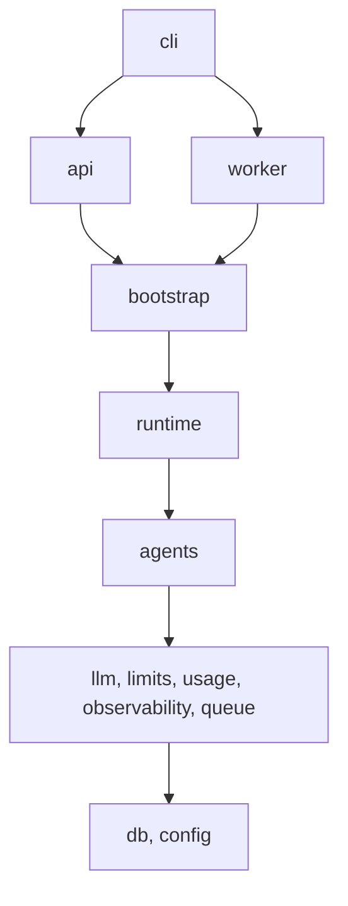

# ranvier

[Español](#español) | [English](#english)

## Español

ranvier es una plataforma para ejecutar agentes y flujos de IA, escritos como `StateGraph` planos de LangGraph 1.x, en producción. Se instala como paquete Python (import `ranvier`, CLI `ranvier`): registra los flujos desde un manifiesto, los ejecuta de forma durable sobre Postgres y los expone por CLI, HTTP/SSE y un worker de cola. Los productos dependen del paquete por tag de git y solo contienen sus flujos, herramientas y configuración.

Características:

- Flujos como `StateGraph` planos, sin DSL propio; descubrimiento por manifiesto `ranvier.toml` (`nombre -> "módulo:objeto"`).
- Ejecución durable: un único runner, checkpointer en Postgres y tabla de runs con leases y recuperación de runs huérfanos.
- Cola y cron con Procrastinate sobre Postgres; un solo lock por `thread_id`.
- API HTTP propia (FastAPI) con eventos SSE, autenticación por API keys o hook propio.
- Adaptador MCP sobre el SDK oficial (`mcp` v2, Streamable HTTP) y kit de agentes con subagentes (`as_tool`).
- Perfiles de LLM (OpenAI, Anthropic, Ollama como extras), registro de uso con costo indicativo y trazas OTLP opcionales.
- Starter Copier para crear repos de producto, con Docker Compose, CI y tests con modelo falso (`ranvier.testing`).

### Inicio rápido

Requisitos: [uv](https://docs.astral.sh/uv/), Docker y Python 3,13 o superior.

Crear un producto desde el starter (`ranvier_tag` por defecto: `v0,1,0`):

```bash
uvx copier copy https://github.com/Wysted/ranvier.git mi-producto
cd mi-producto
uv lock && uv sync                # la primera vez; commitear uv.lock
cp .env.example .env              # editar API_KEY_ADMIN; nunca commitear .env
export UV_ENV_FILE=.env           # uv run carga .env en el entorno
docker compose up -d db           # Postgres en 127,0,0.1:25432
uv run ranvier validate           # compila cada flujo del manifiesto
uv run ranvier migrate            # esquema, tablas del checkpointer y cola
uv run ranvier serve              # API HTTP
uv run ranvier worker             # runs en segundo plano, crons, recuperación
```

El perfil por defecto usa Ollama (`ollama pull qwen3:4b`). Todos los subcomandos: `ranvier --help`; más detalles en el README que genera el starter.

Probar los ejemplos de este repositorio (sin base de datos), desde la raíz:

```bash
RANVIER_CONFIG=examples/ranvier.toml uv run ranvier validate --offline
RANVIER_CONFIG=examples/ranvier.toml uv run ranvier run hello --memory --input '{"name": "Ada"}'
```

### Arquitectura

Monorepo uv: `packages/core` (distribución `ranvier`), `examples/`, `starter/` (plantilla Copier), `bench/`. Dentro del núcleo, las capas están impuestas con import-linter (de arriba hacia abajo):



La superficie pública es solo `ranvier` y `ranvier.testing`; todo lo de `ranvier._internal` puede cambiar. Diseño completo, contratos de importación y decisiones: [docs/design.md](docs/design.md).

### Bench

Runs concurrentes contra Postgres con un LLM falso que solo duerme (un proceso, sin capa HTTP; Ryzen 9 5950X en WSL2, Postgres 18, pools por defecto). Cada run son 5 superpasos de 0,5 s, salvo la última fila (20 pasos sin latencia de modelo).

| N | p50 | p95 | Lag máx. del loop | Pico RSS |
|---|-----|-----|-------------------|----------|
| 10 | 2,611 s | 2,622 s | 1,4 ms | 138,2 MiB |
| 50 | 2,773 s | 2,832 s | 3,0 ms | 141,2 MiB |
| 100 | 2,935 s | 3,111 s | 4,3 ms | 144,8 MiB |
| 200 | 3,319 s | 3,549 s | 5,5 ms | 151,7 MiB |
| 200 (20 pasos, sin modelo) | 8,151 s | 8,473 s | 3,8 ms | 149,1 MiB |

Con N=200 el sobrecosto de la plataforma es de unos 0,16 s por paso; sin modelo, unos 470 pasos/s en un proceso. Metodología, límites y resultados completos: [bench/results-v0.1.md](bench/results-v0.1.md).

### Desarrollo

```bash
docker compose up -d                              # Postgres de desarrollo
scripts/check.sh                                  # ruff, format, mypy, import-linter, tests unitarios
cd packages/core && uv run pytest -m integration  # integración (requiere el Postgres de compose)
```

Parte del código se escribió con agentes de IA; los briefs de las tareas están en [docs/tasks](docs/tasks.md).

### Licencia

[MIT](LICENSE).

## English

ranvier is a platform for running agents and AI flows, written as plain LangGraph 1.x `StateGraph`s, in production. It installs as a Python package (import `ranvier`, CLI `ranvier`): it registers flows from a manifest, runs them durably on Postgres and exposes them through the CLI, HTTP/SSE and a queue worker. Products depend on the package by git tag and only hold their own flows, tools and configuration.

Features:

- Plain `StateGraph` flows, no custom DSL; discovery through a `ranvier.toml` manifest (`name -> "module:object"`).
- Durable execution: a single runner, a Postgres checkpointer and a runs table with leases and orphan-run recovery.
- Queue and cron with Procrastinate on Postgres; one lock per `thread_id`.
- Own HTTP API (FastAPI) with SSE events, authentication by API keys or a custom hook.
- MCP adapter over the official SDK (`mcp` v2, Streamable HTTP) and an agents kit with subagents (`as_tool`).
- LLM profiles (OpenAI, Anthropic, Ollama as extras), a usage ledger with indicative cost and optional OTLP tracing.
- Copier starter to create product repos, with Docker Compose, CI and tests using a fake model (`ranvier.testing`).

### Quickstart

Requirements: [uv](https://docs.astral.sh/uv/), Docker and Python 3.13 or newer.

Create a product from the starter (default `ranvier_tag`: `v0.1.0`):

```bash
uvx copier copy https://github.com/Wysted/ranvier.git my-product
cd my-product
uv lock && uv sync                # first time; commit uv.lock
cp .env.example .env              # edit API_KEY_ADMIN; never commit .env
export UV_ENV_FILE=.env           # uv run loads .env into the environment
docker compose up -d db           # Postgres on 127.0.0.1:25432
uv run ranvier validate           # compile every flow in the manifest
uv run ranvier migrate            # schema, checkpointer tables, job queue
uv run ranvier serve              # HTTP API
uv run ranvier worker             # background runs, crons, recovery
```

The default profile uses Ollama (`ollama pull qwen3:4b`). All subcommands: `ranvier --help`; more details in the README the starter generates.

Try this repository's examples (no database), from the root:

```bash
RANVIER_CONFIG=examples/ranvier.toml uv run ranvier validate --offline
RANVIER_CONFIG=examples/ranvier.toml uv run ranvier run hello --memory --input '{"name": "Ada"}'
```

### Architecture

uv monorepo: `packages/core` (distribution `ranvier`), `examples/`, `starter/` (Copier template), `bench/`. Inside the core, layers are enforced with import-linter (top to bottom):


The public surface is only `ranvier` and `ranvier.testing`; everything under `ranvier._internal` may change. Full design, import contracts and decisions: [docs/design.md](docs/design.md).

### Bench

Concurrent runs against Postgres with a fake LLM that only sleeps (one process, no HTTP layer; Ryzen 9 5950X on WSL2, Postgres 18, default pools). Each run is 5 supersteps of 0.5 s, except the last row (20 steps, no model latency).

| N | p50 | p95 | Max loop lag | Peak RSS |
|---|-----|-----|--------------|----------|
| 10 | 2.611 s | 2.622 s | 1.4 ms | 138.2 MiB |
| 50 | 2.773 s | 2.832 s | 3.0 ms | 141.2 MiB |
| 100 | 2.935 s | 3.111 s | 4.3 ms | 144.8 MiB |
| 200 | 3.319 s | 3.549 s | 5.5 ms | 151.7 MiB |
| 200 (20 steps, no model) | 8.151 s | 8.473 s | 3.8 ms | 149.1 MiB |

At N=200 the platform overhead is about 0.16 s per step; with no model, about 470 steps/s in one process. Methodology, limits and full results: [bench/results-v0.1.md](bench/results-v0.1.md).

### Development

```bash
docker compose up -d                              # development Postgres
scripts/check.sh                                  # ruff, format, mypy, import-linter, unit tests
cd packages/core && uv run pytest -m integration  # integration (needs the compose Postgres)
```

Part of the code was written with AI agents; the task briefs are in [docs/tasks](docs/tasks.md).

### License

[MIT](LICENSE).
