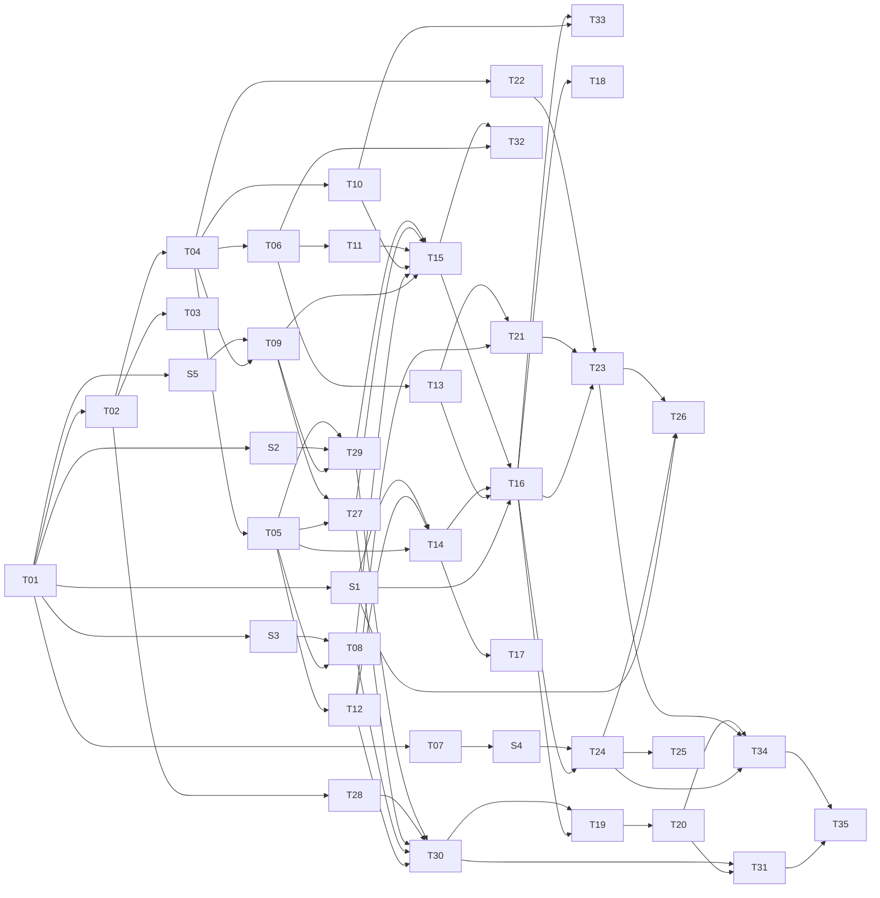

# graph-agent v0.1 tasks

Source: `docs/design.md` section 14 (parts 1-12) split into reviewable tasks. Each task: implement -> `sa-review-py` -> fixes in a separate commit -> `/ponytail-audit` on what it touched. Parallel tasks need isolated git worktrees (one writer per worktree); otherwise run them in the listed order.

## Tasks

| ID | Task | Part | Depends on | Owner | Brief | Status |
|----|------|------|------------|-------|-------|--------|
| T01 | `git init`, `.gitignore`, uv workspace root, `packages/core/pyproject.toml` (deps, extras `[openai]` `[anthropic]` `[ollama]` `[otel]`), empty `graph_agent` with `py.typed` | 1 | - | sa-build-py | [T01](tasks/T01-workspace-skeleton.md) | done |
| T02 | Tooling: ruff (with `banned-api`), mypy strict, import-linter contracts C1-C6, pytest config, `blockbuster`, `scripts/check.sh` | 1 | T01 | sa-build-py | [T02](tasks/T02-tooling-gate.md) | done |
| T03 | CI: clean install, `check.sh`, git-subdirectory install check | 1 | T02 | sa-build-py | [T03](tasks/T03-ci-workflow.md) | done |
| T04 | `config/settings.py`: root `Settings` (env + `.env` + `graph-agent.toml`, prefix `GRAPH_AGENT_`) | 2 | T02 | sa-dev-py | [T04](tasks/T04-settings.md) | done |
| T05 | `config/manifest.py`: flows, tools, crons, mcp, profiles models; lazy `module:object` import | 2 | T04 | sa-dev-py | [T05](tasks/T05-manifest.md) | done |
| T06 | `db/pool.py`, `db/migrate.py` (advisory lock), `migrations/0001_init.sql` (`runs` with partial unique index, `usage`) | 4 | T04 | sa-dev-py | [T06](tasks/T06-db-migrations.md) | done |
| T07 | Dev `docker-compose.yml` (Postgres) and integration-test marker | 4 | T01 | sa-build-py | [T07](tasks/T07-dev-compose.md) | done |
| T08 | `llm.py`: profiles -> `init_chat_model`, one shared httpx client per provider | 3 | T05, S3 | sa-dev-py | [T08](tasks/T08-llm-profiles.md) | done |
| T09 | `limits.py`: semaphores, run admission, bounded thread/process executors, loop-lag sampler | 3 | T04, S5 | sa-dev-py | [T09](tasks/T09-limits.md) | done |
| T10 | `observability/tracing.py` port + lazy `otlp.py` adapter | 3 | T04 | sa-dev-py | [T10](tasks/T10-tracing-port.md) | done |
| T11 | `runtime/checkpointer.py` (AsyncPostgresSaver / InMemorySaver) + checkpointer setup in `migrate` | 4 | T06 | sa-dev-py | [T11](tasks/T11-checkpointer.md) | done |
| T12 | `runtime/events.py` + `runtime/context.py` (`RunContext`, `FlowContext`) | 5 | T05 | sa-dev-py | [T12](tasks/T12-events-context.md) | done |
| T13 | `runtime/runs.py`: state machine, conditional claims, leases, cancel flag | 5 | T06 | sa-dev-py | [T13](tasks/T13-runs-repository.md) | done |
| T14 | `runtime/flows.py`: resolution, lazy compile cache, version checks | 5 | T05, T12, S1 | sa-dev-py | [T14](tasks/T14-flow-registry.md) | done |
| T15 | `bootstrap.py`: Container + AsyncExitStack wiring pools, LLM, limits, tracing, checkpointer | 3 | T08, T09, T10, T11, T27, T29 | sa-dev-py | [T15](tasks/T15-bootstrap.md) | done |
| T16 | `runtime/runner.py`: `execute_run` (claim, astream v2 -> events, heartbeat, run timeout, cancel) | 5 | T13, T14, T15, S1 | sa-dev-py | [T16](tasks/T16-runner.md) | todo |
| T17 | `cli.py` part 1: `validate [--diagram] [--offline]` | 2 | T14 | sa-dev-py | [T17](tasks/T17-cli-validate.md) | done |
| T18 | `cli.py` part 2: `migrate`, `run [--memory]` | 5 | T16 | sa-dev-py | [T18](tasks/T18-cli-migrate-run.md) | todo |
| T19 | `testing.py`: fake chat model fixture, in-memory path, flow test helper | 6 | T16, T30 | sa-dev-py | [T19](tasks/T19-testing-kit.md) | todo |
| T20 | `examples/`: hello and approval (interrupt) flows with tests | 6 | T19 | sa-dev-py | [T20](tasks/T20-examples-basic.md) | todo |
| T21 | `api/dto.py`: wire DTOs and SSE mapping (`{run_id}:{seq}` ids) | 7 | T12, T13 | sa-dev-py | [T21](tasks/T21-api-dto.md) | done |
| T22 | `api/auth.py`: `Principal`, none (localhost) / static API keys / `module:callable` hook | 7 | T04 | sa-dev-py | [T22](tasks/T22-api-auth.md) | done |
| T23 | `api/app.py` + `api/routes.py`: endpoints, admission (`429`), `serve` | 7 | T16, T21, T22 | sa-dev-py | [T23](tasks/T23-api-app-routes.md) | todo |
| T24 | `queue.py` + `worker.py`: Procrastinate app, execute job with `lock=thread_id` | 8 | T16, S4 | sa-dev-py | [T24](tasks/T24-queue-worker.md) | todo |
| T25 | Worker housekeeping: stalled jobs, orphan sweep, checkpoint prune, crons; `worker` and `crons` CLI | 8 | T24 | sa-dev-py | [T25](tasks/T25-worker-housekeeping.md) | todo |
| T26 | Graceful shutdown: SIGTERM -> stop admission, `RunControl.request_drain()`, requeue; shutdown timeouts | 8 | T23, T24, S1 | sa-dev-py | [T26](tasks/T26-graceful-shutdown.md) | todo |
| T27 | `agents/spec.py` + `agents/tools.py`: `AgentSpec`, tool registry, timeout/semaphore wrappers, thread/process isolation | 9 | T05, T09 | sa-dev-py | [T27](tasks/T27-agent-spec-tools.md) | done |
| T28 | `agents/skills.py`: SKILL.md loader + `load_skill` middleware | 9 | T02 | sa-dev-py | [T28](tasks/T28-skills.md) | done |
| T29 | `agents/mcp.py`: `McpToolSource` port + own adapter over `mcp` SDK v2, tests with in-process FastMCP | 9 | T05, T09, S2 | sa-dev-py | [T29](tasks/T29-mcp-adapter.md) | done |
| T30 | `agents/factory.py`: `build_agent`, `as_tool`, `ctx.agent(spec)` | 9 | T08, T12, T27, T28, T29 | sa-dev-py | [T30](tasks/T30-agent-factory.md) | done |
| T31 | `examples/` research flow (subagent + MCP) with tests | 9 | T20, T30 | sa-dev-py | [T31](tasks/T31-example-research.md) | todo |
| T32 | `usage.py`: ledger callback, repository, `usage` CLI report (genai-prices at read time) | 10 | T06, T15 | sa-dev-py | [T32](tasks/T32-usage-ledger.md) | todo |
| T33 | OTel span attributes and metrics in the runner (incl. loop lag gauge) | 10 | T10, T16 | sa-dev-py | [T33](tasks/T33-otel-runner.md) | todo |
| T34 | `starter/` Copier template + `copier update` docs | 11 | T20, T23, T24 | sa-dev-py | [T34](tasks/T34-starter-copier.md) | todo |
| T35 | Bench run and exit check | 12 | all | sa-build-py | [T35](tasks/T35-bench-exit-check.md) | todo |

## Spikes (verify open checks before the dependent task; findings update `design.md`)

| ID | Verify | Unblocks | Depends on | Brief | Status |
|----|--------|----------|------------|-------|--------|
| S1 | `RunControl` import path and use with `astream` in installed langgraph 1.2.x; runtime context reaches nodes without `context_schema`; checkpoint metadata carries `metadata.run_id` | T14, T16, T26 | T01 | [S1](tasks/S1-langgraph-runtime-checks.md) | done |
| S2 | `mcp` SDK v2 `Client`: one session reused for the process, reconnect after server restart, one failing request does not kill concurrent ones (#2604) | T29 | T01 | [S2](tasks/S2-mcp-sdk-session.md) | done |
| S3 | Each provider integration accepts a shared `http_async_client` with limits; `create_agent(name=...)` shows in callback metadata | T08, T30 | T01 | [S3](tasks/S3-provider-http-clients.md) | done |
| S4 | Procrastinate: periodic tasks from config, stalled-jobs API, schema upgrade path; `AsyncPostgresSaver` per-instance write lock claim | T24, T25 | T01, T07 | [S4](tasks/S4-procrastinate-checkpointer.md) | todo |
| S5 | `ProcessPoolExecutor.kill_workers` on 3.14 and fallback on 3.13; langgraph on 3.14 | T09 | T01 | [S5](tasks/S5-process-pool-py314.md) | done |

## Parallel waves

Tasks in the same wave are independent of each other.

| Wave | Tasks |
|------|-------|
| A | T01 |
| B | T02, T07, S1, S2, S3, S5 |
| C | T03, T04, T28, S4 |
| D | T05, T06, T09, T10, T22 |
| E | T08, T11, T12, T13, T27, T29 |
| F | T14, T15, T21, T30 |
| G | T16, T17, T32 |
| H | T18, T19, T23, T24, T33 |
| I | T20, T25, T26 |
| J | T31, T34 |
| K | T35 |

Critical path: T01 -> T02 -> T04 -> T05 -> T08 -> T15 -> T16 -> T19 -> T20 -> T31/T34 -> T35.

T35 note: design.md proposes "agintis flows run unchanged on graph-agent" as the exit check; that criterion is not decided yet. Until it is, T35 runs the `examples/` flows under `bench/`.
